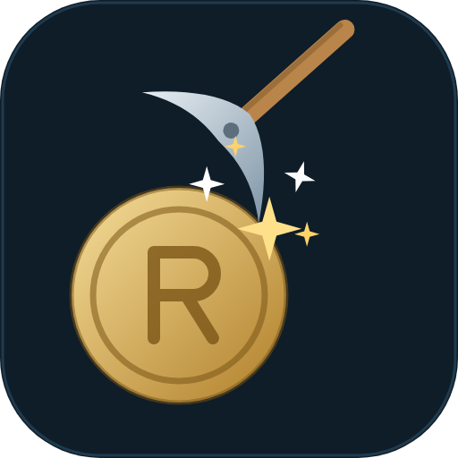
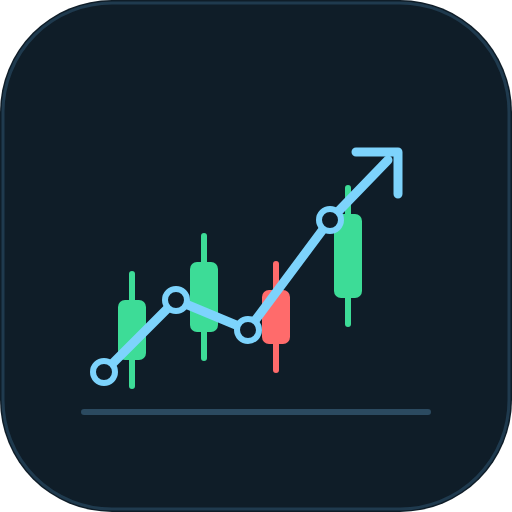
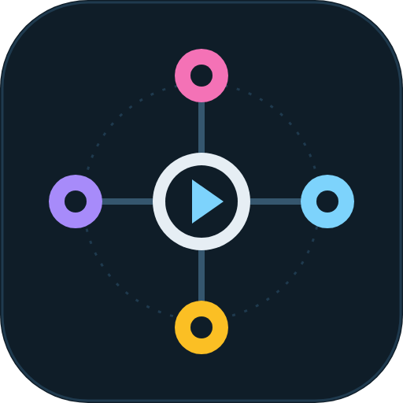
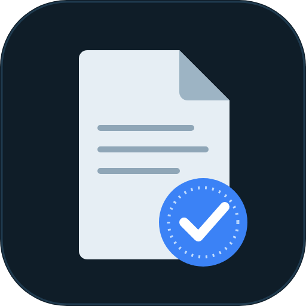
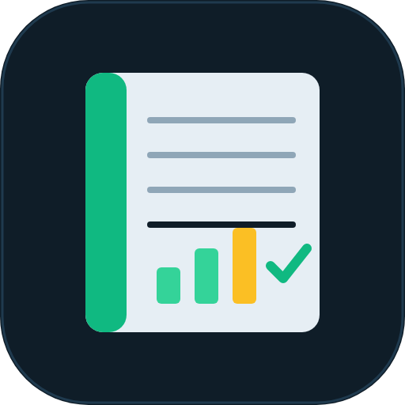
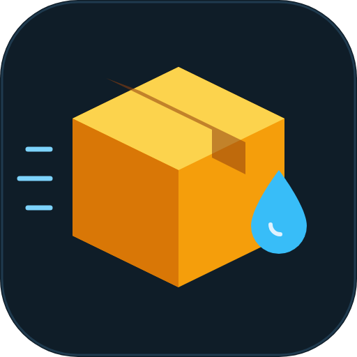

# REML Holding Trust

International holding company that designs, builds and licenses software under the **REML** name.
Every product is engineered in-house with test-driven development and mutation testing, and is delivered as a single installer.

## Products

| | Product | What it is | Status |
| :-: | --- | --- | --- |
|  | **REMLInvest** | Cryptocurrency mining for PC and Android, built for people who know nothing about crypto: guided setup, separate CPU and GPU limits, live hardware gauges, no console windows. | In development |
|  | **REMLInvestBot** | Trading AI that decides from news, price history and the track record of each source, with the amounts the user authorises. | In development, simulation only |
|  | **REMLDirector** | A director for local AI agents: it picks which local model to open (text, image, video, audio), runs it, closes it and reports back. | In development |
|  | **REMLDocs** | Runs an online store of templates and personalised documents on its own: order, contract, unique reference, protected PDF and delivery. | In development |
|  | **REMLTales** | Children's tales personalised with the child's name and face, read aloud, printable as a book. | In development |
|  | **REMLAccounting** | Automatic bookkeeping for an international holding, driven by the web sales. | Not started |
|  | **REMLDrop** | AI for dropshipping. | Not started |
|  | **REML Graphics** | Graphics and game engine written in Rust: rendering, rigid-body physics, destruction, liquids, soft bodies, vehicles and procedural terrain. | In development |

Detailed descriptions and how each differs from existing tools: see `docs/PROGRAMAS.md` in the REML Graphics repository and `PRODUCTO.md` in each product repository.

## How we work

**Memory-safe by default.** Core engines are written in Rust.

**Proven, not promised.** Test-driven development, with mutation testing so that no mutant survives.

**Deterministic.** Same input, same output, on every machine.

**Simple to install.** One installer, no console windows, no setup puzzles.

## Licensing and contact

Source code is proprietary and private. Products are licensed under agreement.

© REML Holding Trust. All rights reserved.
