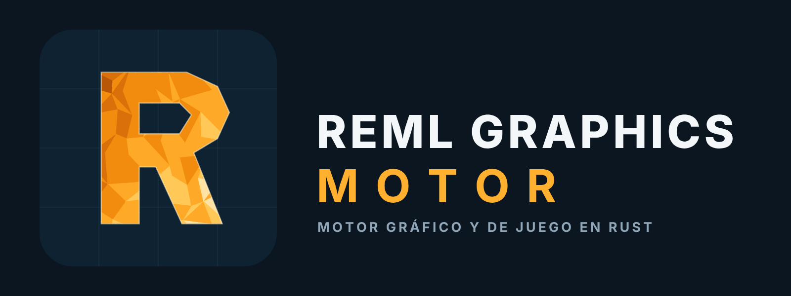

# REML Holding Trust

International holding company that designs, builds and licenses software under the **REML** name.
Every product is engineered in-house with test-driven development and mutation testing, and is delivered as a single installer.

## Products

| Product | What it is |
| --- | --- |
| **REML Graphics Motor** | Graphics and game engine written in Rust. Vulkan and OpenGL 4.5 rendering, rigid-body physics, destruction, liquids, soft bodies, vehicles and procedural terrain. |
| **REML software family** | Further applications are licensed under the same holding. |

## How we work

**Memory-safe by default.** Core engines are written in Rust.

**Proven, not promised.** Test-driven development, with mutation testing so that no mutant survives.

**Deterministic.** Same input, same output, on every machine.

**Simple to install.** One installer, no console windows, no setup puzzles.

## Licensing and contact

Source code is proprietary and private. Products are licensed under agreement.

© REML Holding Trust. All rights reserved.
